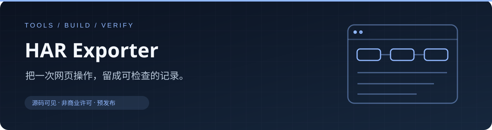

<p align="center"></p>

# HAR Exporter

独立浏览器网络录制工具。记录浏览器能够提供的请求、响应与正文，导出 HAR 1.2；
支持已捕获资源筛选与另存为。Chrome/Edge 与 Firefox 放在同一仓库维护。

**Chrome/Edge 1.5.1 · Firefox 1.4.5 · 预发布 · 源码可见／非商业许可**

扩展不会主动把录制上传到服务器。新录出的 HAR 可能包含 Cookie、Token、个人或支付资料，
分享前仍须检查脱敏。只在有权访问和录制的页面使用。

## 下载与安装

从 [Releases](https://github.com/Alex-Wmz/HAR-Exporter-Public/releases) 下载运行包并完整解压。
**所选目录必须直接包含 `manifest.json`**；仓库根目录和 GitHub Source code ZIP 外层不能直接加载。

| 浏览器 | 当前安装方式 |
| --- | --- |
| Chrome 125+／对应版本 Edge | 在扩展管理页开启开发者模式，加载已解压的运行目录 |
| Firefox 142+ | 在 about:debugging 临时载入 manifest.json；当前未签名，重启后需重载 |

更新前先完成录制、导出并保存重要素材，用新版文件更新同一固定目录，再点击扩展“重新加载”。
不为升级卸载扩展或清理浏览器数据；移目录可能改变扩展身份和保存授权。

## 一次录制

1. 打开目标页，选择保存方式；按需要选择包含图片、音视频或字体正文。
2. 开始录制，再刷新或执行页面操作。此前发生的请求不会补抓。
3. 停止并导出；对在途请求和正文做有限等待。
4. 需要的已捕获资源应在成功导出 HAR 或放弃录制前另存为。

取消保存或保存失败会保留当前内存录制，关闭浏览器或重载扩展会丢失未保存内容。
资源导出使用已经捕获的正文，不重新请求网站，不拼接视频。
HAR 是网络记录，不是操作视频，也不是完整离线网站。

## 容量与数据边界

录制有请求数、正文和元数据预算；缺失数量及原因会显示在弹窗并写入 HAR 的捕获元数据。
文件保存成功只说明该文件已经写入，不证明浏览器提供了全部响应或正文。
容量、浏览器能力、附加前请求、验证码页及分段媒体都会影响结果。
Firefox 不提供与 Chromium 完全相同的录制能力。

Chrome 会在本机保存用户选择的偏好、目录授权及最近一次成功导出信息。
通用运行包不预设个人目录；不包含录制、浏览器资料、登录态、账号或真实业务样本。

## 构建和检查

运行代码无第三方运行依赖；检查需要 Node.js 20+ 和 Python 3.10+。

```powershell
node tools/har-exporter/scripts/verify.mjs
node tools/har-exporter-firefox/scripts/verify.mjs
python -m unittest discover -s tools -p test_har_build.py
python tools/build_har_packages.py --browser all --output dist
```

包按明确文件清单生成，含许可和 SHA256SUMS。构建器检查图像无额外元数据、
引用完整、ZIP 实际条目、解压根清单与字节一致性。源码构建者可加载
`tools/har-exporter` 或相应 Firefox 子目录；不要选择最外层仓库。

## 许可与反馈

自有应用代码采用 [PolyForm Noncommercial 1.0.0](LICENSE)。符合许可的非商业用途免费，
超出许可目的的商业使用需另行书面授权，见 [商业授权导读](COMMERCIAL_LICENSE.md)。
本项目属于源码可见软件，不称为 OSI 意义上的开源。

当前为预发布：代码与打包检查沿发布记录，真实浏览器、另存为和不同网站兼容性仍需逐项验收。
反馈请给合成或公开页面的步骤；不要附真实 HAR、Cookie、Token 或个人路径。
安全问题见 [SECURITY.md](SECURITY.md)。

本工具由维护者提出需求、选择录制边界并核对交付，代码实现使用 AI 辅助。
